# streamingapp

A living-room player for the Stremio addon ecosystem. You browse films and series
on a big screen, pick a source, and watch it in a player built for picture
quality. Your phone works as a full remote control with nothing to install.

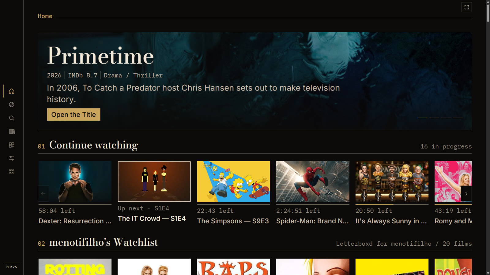

## What it does

- **Browse like a streaming service.** Home shows a featured title, the shows you
  are in the middle of, and one row for each catalog your addons offer. Discover
  lets you browse by genre, and Search finds films and series by name.
- **Pick up where you left off.** *Continue watching* remembers how far you got
  in every film and episode. When you finish an episode, its card moves on to the
  next one, and season finales lead into the next season.
- **Choose your source.** Opening an episode lists every stream your addons
  found, with resolution, codecs, size and language, so you choose what to
  play.
- **A player that keeps the picture intact.** Video is drawn by
  [mpv](https://mpv.io), which keeps HDR and 10-bit colour intact on displays
  that support them. The on-screen controls cover audio and subtitle tracks,
  subtitle timing and size, chapters, playback speed, cropping black bars, and
  previous or next episode.
- **Your phone is a full remote.** Open one address in your phone's browser and
  you can do everything the big screen does: browse, search, choose a stream,
  play, pause, seek, and switch subtitles. The phone and the TV can show
  different screens at the same time. Only playback is shared.
- **Optional extras.** Add a free TMDB key to turn on Discover and richer search.
  Sign in to a Stremio account to see your Stremio library and keep your watch
  progress in sync with it.

| Choosing an episode | Choosing a stream |
|---|---|
| 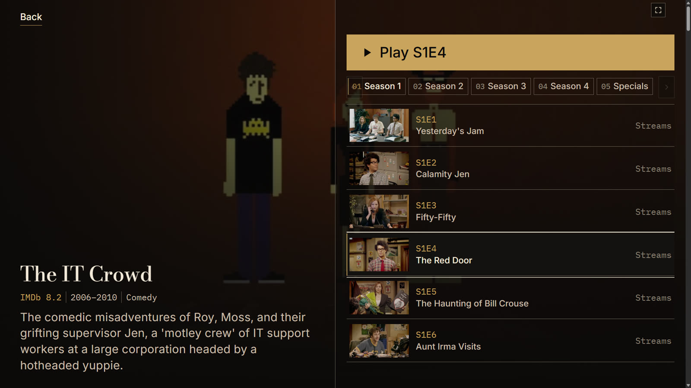 | 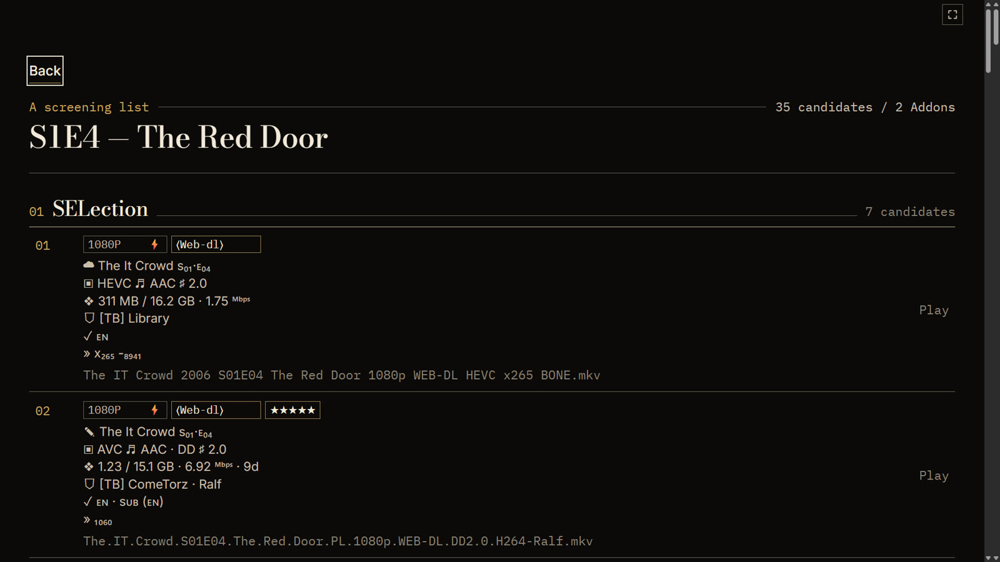 |

| Watching | Subtitles and tracks |
|---|---|
| 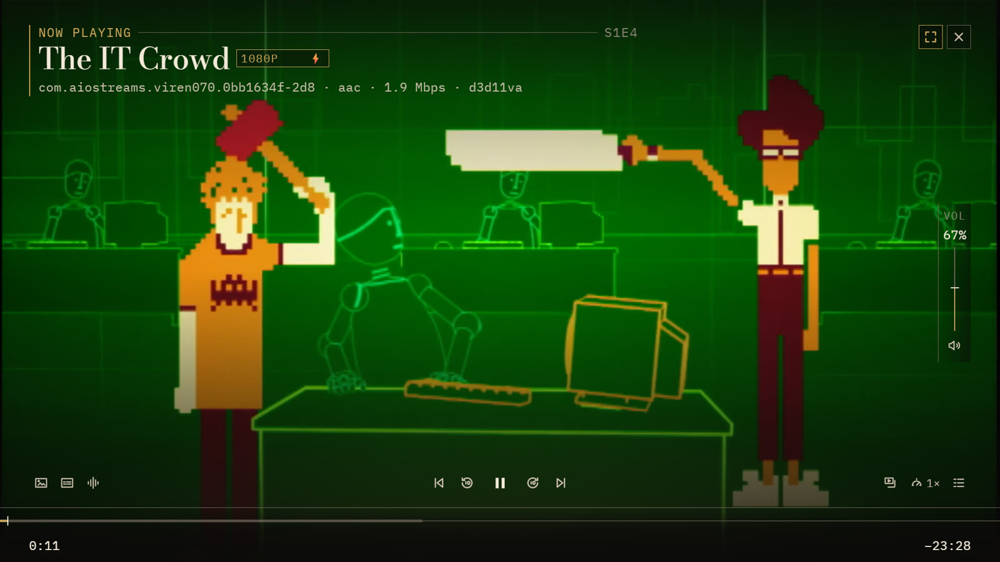 | 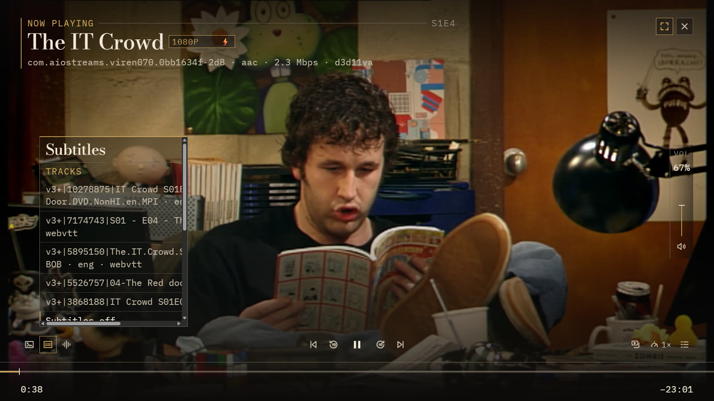 |

## The phone remote

The phone shows the same app in a phone-sized layout. Everything you do on it
happens on the big screen right away:

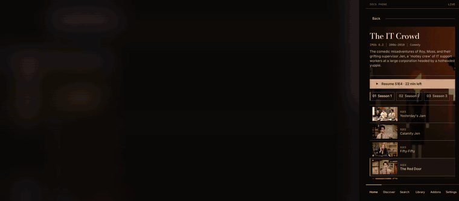

| Home | Episode | Now playing | Audio & Subtitles |
|---|---|---|---|
| 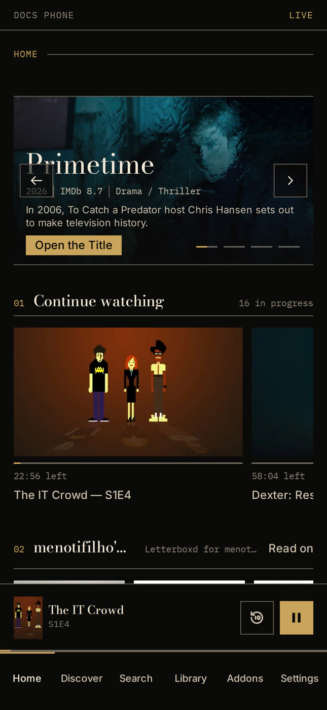 | 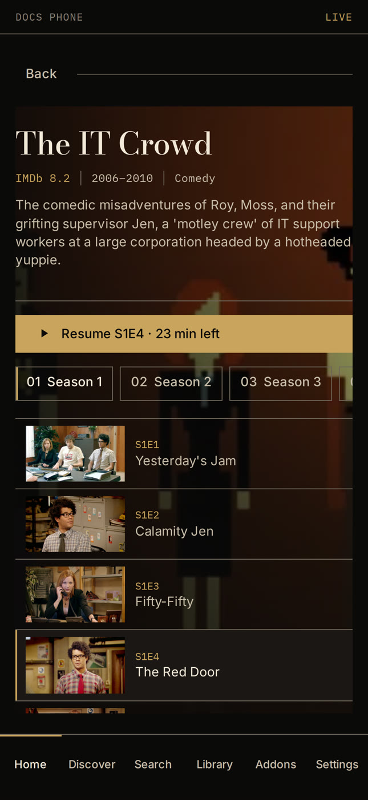 | 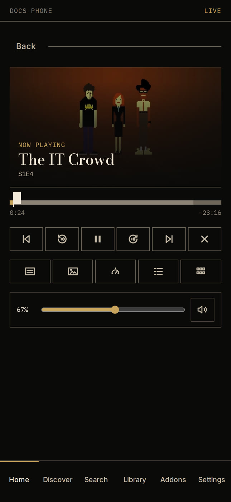 | 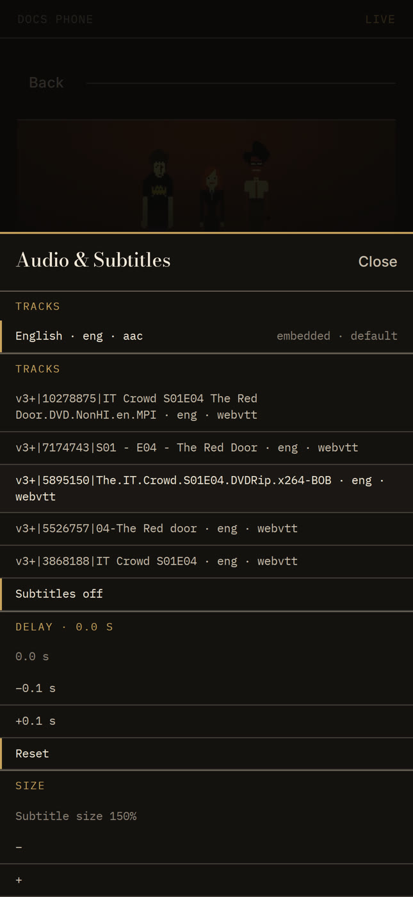 |

## Getting started

### 1. Install

streamingapp runs on **Windows** today. Download the latest
`streamingapp_<version>_x64-setup.exe` from the
[Releases page](../../releases) and run it. It installs for your user only, so
it doesn't need administrator rights, and the player is included.

### 2. Add an addon

streamingapp doesn't come with any content of its own. Everything you see comes
from **addons**, the same ones the Stremio app uses. Open **Addons** in the menu
on the left and paste an addon's address (its *manifest URL*, which usually
ends in `/manifest.json`). Its catalogs appear on Home right away.

Addon addresses can contain personal settings, such as an account key for a
debrid service. streamingapp keeps that address on your computer and never
shows it to the phone remote.

### 3. Optional: TMDB and Stremio

Open **Settings → Credentials**:

- **TMDB key**: turns on **Discover** and searches by title across everything,
  not just your addons. A key is free from
  [themoviedb.org](https://www.themoviedb.org/settings/api).
- **Stremio account**: fills the **Library** with the titles saved in your
  Stremio account, and keeps your watch progress in sync with it.

Both are stored in Windows' own credential store, not in a plain file.

### 4. Pair your phone

1. On the big screen, open **Settings → Remote devices**. It shows an
   **address** (like `192.168.1.20:8090`) and a short **pairing code**.
2. On your phone, connected to the same Wi-Fi, open that address in the browser.
3. Type the code and give the phone a name. You're in.

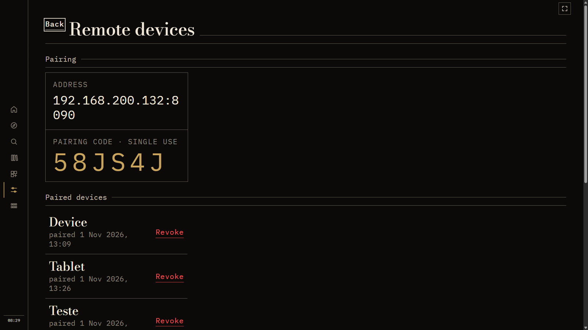

Each code works once. Each phone stays paired until you **Revoke** it from the
same screen. Revoking one phone doesn't affect the others.

## Getting around

- **Mouse**: click as usual. Move the mouse during playback to bring up the
  controls.
- **Keyboard or remote**: use the arrow keys to move, **Enter** to choose, and
  **Escape** to go back. Moving left from the page opens the menu. **F11**
  toggles full screen.
- **Game controller**: the D-pad and buttons work the same way.

In the player, **Escape** stops playback and returns you to where you were. Your
place is saved, so the title shows up in *Continue watching*.

## Settings worth knowing

**Settings → Preferences** has the choices that apply everywhere, on the big
screen and the phone alike:

- the subtitle language picked automatically, and the subtitle colour and size;
- how much video to load ahead, so a slow network causes fewer interruptions;
- whether **Play** on a show's next episode starts it straight away or lets you
  choose the stream first;
- which addon catalog feeds the large featured banner on Home.

## Your data

Everything stays on your computer, in `%APPDATA%\dev.streamingapp.host\`: your
addons, watch progress, preferences and a log file. Uninstalling the app leaves
it there, so a reinstall picks up where you left off. Nothing is sent anywhere
except to the addons you added, to TMDB if you gave it a key, and to Stremio if
you signed in.

## Troubleshooting

- **The phone can't reach the address.** Make sure the phone is on the same
  network as the computer, and that Windows Firewall allows streamingapp on
  private networks.
- **A stream won't play.** Some sources are marked as unplayable. They need a
  torrent client, which streamingapp doesn't include. Pick another one from the
  list, ideally from a debrid service or a direct link.
- **Nothing on Home.** You haven't added an addon yet, or the addon isn't
  answering. The row says which.

## License

streamingapp is free software under the **GNU General Public License v3.0 or
later**, because it includes mpv. It is an independent project, not affiliated
with Stremio, and it provides no content: what you watch comes from the addons
you choose to add. It uses the TMDB API but is not endorsed or certified by
TMDB.

---

Working on the code? Start with [`AGENTS.md`](AGENTS.md),
[`CONTEXT.md`](CONTEXT.md) and [`docs/architecture.md`](docs/architecture.md).
