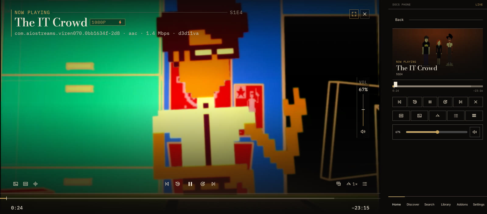
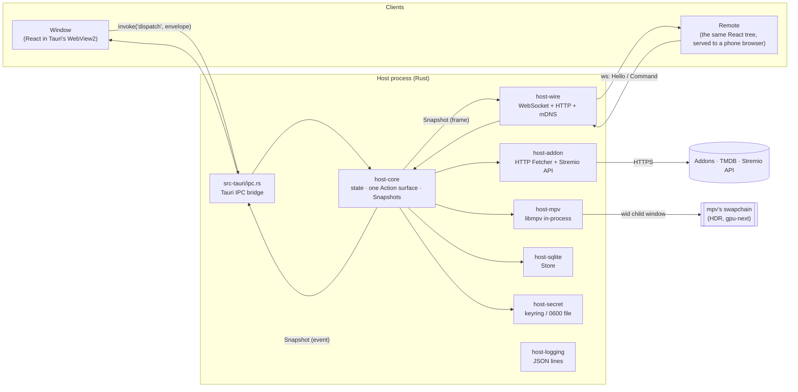

# Architecture

An internal guide to how streamingapp is built: the parts, what each one owns,
how a press on a screen becomes a picture on the TV, and the rules that keep the
parts apart. It's a map, not the record. Decisions and their reasons live in
[`docs/adr/`](adr/), the vocabulary in [`CONTEXT.md`](../CONTEXT.md), the
evidence in [`docs/research/`](research/), and the visual language in
[`design-system.md`](design-system.md). Where this page and an ADR disagree, the
ADR wins and this page is stale.

Words in **bold** below are glossary terms from `CONTEXT.md` (Host, Action,
Question, Change, Snapshot, Title, Video, Stream, Player…). The code uses them
exactly, and so should any change to it.

---

## 1. The shape in one picture





There are three ideas in that picture, and most of the codebase follows from
them.

1. **The Host is authoritative.** All state lives in one Rust process: the
   configured Addons, preferences, credentials, paired Devices, Watch progress,
   the Title cache and playback. Clients hold no state the Host would need
   back. (ADR-0002)
2. **There is one door.** Every client, the Host's own window included, changes
   the Host only by sending a versioned **Action** through the same surface,
   and learns about state only from the **Snapshots** the Host publishes. The
   window has no private path. A capability is added to the surface, never to
   one client, which is why the phone remote can do everything the window can.
   (ADR-0002, ADR-0008, ADR-0018)
3. **mpv owns the picture.** The video is never composited by the UI. libmpv is
   linked in-process and given a child window (`wid`). It draws into its own
   swapchain with `vo=gpu-next`, and that is what keeps HDR passthrough and 10-bit
   possible. The UI is a transparent WebView layered *above* that child window.
   This is also why the project is GPL-3.0. (ADR-0003, ADR-0004, ADR-0007)

---

## 2. Repository map

```
Cargo.toml              Rust workspace (crates/* + src-tauri)
crates/
  host-core/            the Host's domain: state, Actions, Snapshots, every seam
  host-addon/           the real Fetcher (blocking HTTPS) and Stremio API client
  host-mpv/             the real Player (+ the silent Previewer for seek stills)
  host-sqlite/          the real Store; the only SQL and schema in the repo
  host-secret/          the real SecretStore: OS keyring or owner-only file
  host-wire/            the remote's transport: WebSocket, HTTP page, mDNS
    remote/             the BUILT remote client (committed; compiled into the binary)
  host-logging/         JSON-lines logs in the data directory
  host-live/            `live_check`: read-only conformance run against real Addons
src-tauri/              the thin app shell: wiring, window, IPC, timers; no rules
src/                    the React/TypeScript client (one tree, two entries)
  core/                 client decisions shared by window and remote (pure, tested)
  core/react/           React bindings of the core (hooks, motion presets)
  kit/                  screen-agnostic primitives, tokens.css, icons
  window/               the ten-foot client (the Host's own window)
    repertory/          its screens, in the Repertory design language
  remote/               the phone client (the "Cast Remote")
index.html, remote.html the two Vite entries
docs/                   ADRs, research notes, design system, agent docs, this file
scripts/                ci.sh / cd.sh (local CI/CD), windows/ (build + by-hand verify)
docker/, compose*.yaml  the dev container: the only place toolchains live
```

The crate split follows one rule: **`host-core` knows nothing about Tauri,
the network, SQL or mpv.** Each of those sits behind a trait (a *seam*) that
`host-core` defines, with an in-memory or fixture implementation in `host-core`
for tests and a real implementation in its own crate. `cargo test -p host-core`
therefore never compiles a UI toolkit, a TLS stack or libmpv, and most of the
behaviour is tested there. (ADR-0008, ADR-0009, ADR-0013)

| Seam (in `host-core`) | Test double | Real implementation |
|---|---|---|
| `Store` | `InMemoryStore` | `host_sqlite::SqliteStore` |
| `Fetcher` | `FixtureFetcher` | `host_addon::HttpFetcher` |
| `StremioApi` | fixture | `host_addon::HttpStremio` |
| `SecretStore` | `InMemorySecretStore` | `host_secret::open()` (keyring or file) |
| `Provider` | `FixtureProvider` | `AddonProvider` (over the Fetcher) |
| `Player` | `FixturePlayer` | `host_mpv` Player, or `NoPlayer` if mpv won't start |
| `Previewer` | fixture | `host_mpv::MpvPreviewer` |
| `Clock` | `FixtureClock` | system clock |

---

## 3. The Host (`crates/host-core`)

### 3.1 Actions: Questions and Changes

An Action arrives as JSON in a versioned envelope:

```json
{"version":1,"action":{"type":"set_subtitle_languages","languages":["pt-BR","en"]}}
```

1. **Parse** (`action.rs`). The version is checked *before* the body, so a
   client that is too old or too new is told exactly that.
2. **Validate.** `Action::validate` consumes the Action and returns a
   `ValidatedAction` built from domain types. Only a validated Action can reach
   state, and the compiler enforces it.
3. **Through the door** (`door.rs`). The Action is classified once, in
   `host-core` (no client classifies):
   - A **Question** reads: browse a Catalog, search, Discover, open a Title,
     find Streams. The door clones a frozen `HostView` (`view.rs`) under a
     short lock and resolves *outside* the lock, so a slow Addon slows down one
     row, not the whole Host. It answers only the client that asked, with an
     `Answer`. It publishes no Snapshot and moves no revision. Questions that ask
     several Addons fan out in parallel under a bound and still answer in
     configured order. (ADR-0010, ADR-0022, ADR-0023)
   - A **Change** mutates: Addons, preferences, credentials, Devices, playback
     controls. It holds the Host's one exclusive lock for all of its I/O. The
     order is: write the Store, *then* replace in-memory state, *then* publish.
     A Change the Store refuses leaves the Host untouched and publishes nothing.
4. **Respond** (`response.rs`): a `Response` carrying the Answer and/or the
   Snapshots to publish.

The door also writes the timing log lines: the Action's kind, the Addon it
named, the duration and the outcome. It never logs payloads, URLs or queries.

### 3.2 Snapshots

`snapshot.rs` builds the Snapshot with a pure function of state. It is the
*only* shape state leaves the Host in, and it is designed so that secrets
**can't be represented** in it. It has no field a credential, a manifest URL or
a Stream URL could occupy (a Stream URL can carry a debrid session), and a test
(`the_snapshot_declares_only_fields_it_can_safely_carry`) holds that line. What a
Snapshot says about playback is **Now playing**: the Video, the Addon it came
from, and the candidate's own description, never where its bytes are.

Snapshots are published to **every** client: the window over a Tauri event and
each paired remote over the WebSocket. A client can't tell which transport
carried one.

### 3.3 Where the Host's data comes from

- **Addons** (`addon.rs`, `catalog.rs`, `meta.rs`, `stream.rs`, `subtitles.rs`):
  the Stremio addon protocol. An Addon is identified by its Manifest's id, and
  its manifest URL is treated as a credential because services like AIOStreams
  put configuration in it. It stays in the Store and never enters a Snapshot.
  (ADR-0009, ADR-0011)
- **Provider** (`provider.rs`): the seam that turns a Video into **Streams**.
  Today the only Provider is `AddonProvider`. Direct sources (local files,
  TorBox…) would arrive as further Providers with nothing above them changing.
  A Stream is a direct URL or a torrent (an `infoHash`, or a `magnet:`). A
  torrent is served by the **Torrent engine** seam (`torrent.rs`) before the
  Player opens it, in `Host::open_stream`, and carries the `p2p` warning whether
  or not its Addon says so. (ADR-0012, ADR-0042)
- **TMDB** (`tmdb.rs`, `discover.rs`, `search.rs`): the Host's metadata source.
  It keys Titles by TMDB id where one exists, powers **Discover** and Search
  (with the Addons' own search catalogs as the fallback when no key is held),
  and bridges ids so a Discovered Title can ask every Addon for its Streams.
  (ADR-0020)
- **Stremio account** (`stremio.rs`, `sync.rs`, `library.rs`): optional. Signing
  in exchanges email and password once for an `authKey`, which goes to the
  secret store. The Library room is a read-only projection of the account's
  `libraryItem` collection. Account sync merges Watch progress both ways,
  newest timestamp wins, and per-episode watched bitfields are merged. With no
  sign-in, the Host makes zero calls to Stremio. (ADR-0016, ADR-0029)

### 3.4 Caches and the background queue

- **Catalog page cache** (`cache.rs`): in memory, short-lived. It records
  "what an Addon said a minute ago".
- **Title cache** (`title_cache.rs`): on disk in the Store, bounded by count.
  Every Title read from an Addon, TMDB or both is kept. Opening a cached Title
  answers from the Store at once, with no network. This matters for
  Continue watching and **Up next**, which must work offline. A stale entry is
  answered as-is, and a refresh is queued. (ADR-0038)
- **Background queue** (`background.rs`): refreshes and read-aheads run outside
  the change lock. If a refresh comes back different, a *revised Answer* goes
  to the client that asked; it isn't a Snapshot. If a read moves Continue
  watching, that is published as a Snapshot, because that row is shared state.
  A **look hint** from a client (it is looking at a Title) only queues a
  read-ahead.

`host-core` owns **no threads and no timers**. Draining the queue and sampling
the Player are the shell's job (§5), and tests drain the queue inline.

### 3.5 Playback, progress, Continue watching

- `playback.rs`: the session. It handles opening a Stream, the Player's reports,
  and every control as a **Telling**: one enum (`Pause`, `Seek`, `AudioTrack`,
  `SubtitleTrack`, `SubtitleDelay`, `Speed`, `Volume`, `Muted`, `Chapter`,
  `Crop`, `Autocrop`, `Aspect`, …) through one `Player::tell` method. A control
  moves the Host's own record immediately (so every client sees it at once), and
  the Player's next report corrects it. Next and previous episode, and Up next
  continuity (replaying the same release), live here too. (ADR-0013, ADR-0014,
  ADR-0021)
- `progress.rs`: **Watch progress** is written while playing, so it survives a
  killed Host. **Continue watching** is built from it: one card per Title,
  newest first, where a finished episode's card becomes its **Up next**.
  Specials come last and stand apart. (ADR-0015, ADR-0039)
- `autoplay.rs`: **Autoplay**, the Host's own 5-second countdown to the next
  episode when a Stream ends. It is published in `PlaybackSnapshot.autoplay`,
  anchored to the `Clock` and checked in `Host::sample()`, so the Host advances
  with no client attached and every client draws the same digit. After three
  auto-advances nobody touched it holds on "Still watching?". (ADR-0040)
- `preview.rs`: **Seek previews**, the still frames above the timeline. These are
  the only frames that ever cross the Player seam, produced by a *second, silent*
  libmpv instance on request, never at frame rate. (ADR-0028)
- The **playback clock is projected** by the clients. The Host folds every
  Player sample into its own record, but a moving position alone doesn't
  publish. A Snapshot goes out on a *public* change (state, tracks, buffered
  span, volume…) or on the Watch progress write every 5 s, and each client
  projects the position from the last anchor. (ADR-0033)

### 3.6 Pairing and Devices

`pairing.rs`, `device.rs` and `wire.rs` (the codec). The Host shows a single-use
**Pairing code**. Redeeming it issues a long-lived **Device token** and rotates the
code. The Host stores only the token's *digest*. Every frame a remote sends
carries the token, and revoking the Device ends access for that device alone.
The wire codec (`ClientFrame`: `Hello`, `Command`; `ServerFrame`: `Welcome`,
`Reply`, `Refusal`, `Snapshot`) lives in `host-core` because it is the Host's
vocabulary written down. The wire version *is* the Action version. (ADR-0017)

---

## 4. The outside crates

**`host-addon`.** One blocking `ureq` client, used for everything that reaches
the network. It is blocking on purpose: an async runtime under every test would
cost more than it buys (ADR-0009). It uses native TLS and the platform verifier,
because schannel won't chain against Mozilla's root list. Bodies are capped at
4 MiB, with a 30 s timeout. `HttpStremio` is the Stremio account API client.

**`host-mpv`.** The only crate that names mpv's own words. `telling.rs`
translates a Telling into mpv properties and commands, `observing.rs` reads mpv's
properties back into the Host's terms, and `previewing.rs` is the silent
Previewer. Startup options: `vo=gpu-next` (HDR), `hwdec=auto-safe`,
`keep-open` (so "ended" is a state the Host can see), and `wid` set *before*
`mpv_initialize`. The picture goes through a `Placement`:
- `InWindow(wid)` on Windows: a child of the Host's window;
- `OwnWindow` elsewhere (Wayland and macOS have no `wid`; X11 is unproven, #19);
- `Headless` for tests (`crates/host-mpv/tests/mpv.rs` drives a real mpv).

Autocrop is mpv's own `autocrop.lua`, vendored verbatim and started with
`autocrop-auto=no`, so a client turns it on when it wants it.

**`host-sqlite`.** Implements `Store` over one SQLite file with numbered
migrations (`migrations.rs`). It is the only place SQL or schema text appears.
It holds Addons, preferences, Devices, Watch progress and the Title cache, but
never credentials.

**`host-secret`.** Probes the OS keyring once at startup. If the keyring
answers (even "no entry"), it is used. Otherwise credentials fall back to an
owner-only `secrets.json` in the data directory. Which backend is in use is
published as **Protection** in the Snapshot. The secrets themselves never are.

**`host-wire`.** A small HTTP + WebSocket server on `0.0.0.0:8090`, or whatever
port the OS gives if 8090 is taken; the window shows the real address. It
serves the remote client from `crates/host-wire/remote/`, which is embedded with
`include_dir!`, so **the page travels inside the binary** and the phone needs
nothing but the Host. It announces itself over mDNS as `_streamingapp._tcp`. The
`Surface` trait is the shell's adapter onto the same door the window uses.

**`host-logging`.** A non-blocking JSON-lines writer to `host.log` in the data
directory. The level comes from `RUST_LOG` (default `info`).

**`host-live`.** `cargo run --bin live_check <manifest-url>` asks a real Addon
for its manifest, a catalog, a search, a Title, its Streams and its subtitles,
using the same parsers the Host uses, and prints a report. It is GET-only and
holds no credentials. It never builds a `Host` and asserts nothing on
third-party content. (ADR-0019)

---

## 5. The app shell (`src-tauri/`)

`main.rs` is wiring, and it is meant to stay that way:

1. A single-instance plugin comes first, so two Hosts can never share one
   database. A second launch focuses the first.
2. Resolve the data dir (`%APPDATA%\dev.streamingapp.host\` on Windows), start
   logging, open the Store, and open the secret store.
3. Build the Fetcher, the Player (`player.rs`: mpv in the window's `HWND` on
   Windows, or `NoPlayer` with a reason if mpv won't start, in which case the
   app still browses), the Previewer, and the Stremio client. Assemble the
   `Host`.
4. Register the two IPC commands, `dispatch` and `snapshot` (`ipc.rs`).
5. Start the wire server (`wire.rs`) with the LAN address and the mDNS name.
6. Start the shell's two clocks. **Sampling** asks the Player where playback is
   every 250 ms and publishes a Snapshot only when something public changed
   (§3.5). The **background drain** looks at the queue every 500 ms.

`ipc.rs` is a translator and nothing more. It passes the raw JSON envelope to
`Action::parse_value` (so errors come back in the Host's vocabulary, not
Tauri's), publishes Snapshots over the `snapshot` event, delivers revised Answers
on their own event, and implements `host_wire::Surface` so the remote reaches the
identical door.

**Windows window details** (`player.rs`, `player/windows.rs`,
`tauri.windows.conf.json`). mpv's child window is pushed to the bottom of the
z-order, and the WebView2 above it is transparent and click-through where there
is no UI. While a Stream plays, the page sets `picture-behind` on `<body>` and
stops painting its background. `tauri.windows.conf.json` restates the whole
window entry with `"transparent": true`, because Tauri's JSON Merge Patch
replaces arrays rather than merging them.

---

## 6. The client (`src/`)

One React 19 + TypeScript tree with **two Vite entries** (ADR-0035):

| Entry | Built by | Runs in | Link to the Host |
|---|---|---|---|
| `index.html` → `src/window` | `pnpm build` → `dist/` | Tauri's WebView2 | `TauriLink` (IPC; already "in", pairs nothing) |
| `remote.html` → `src/remote` | `pnpm build:remote` → `crates/host-wire/remote/` | any phone browser | `WebSocketLink` (pairs, then holds a token) |

- **`src/core/`** holds the decisions both clients share: the wire types
  (`wire.ts`, mirroring `host-core`), the **Session** (`session.ts`: the last
  Snapshot, in-flight Actions, refusals), stores for rows and feeds
  (`store.ts`, `homeStore.ts`, `feedStore.ts`), paging, navigation, episodes,
  stream lists, playback controls, the **Pending** state (`inFlight.ts`), and
  input modality. It is pure TypeScript, tested heavily, and contains no markup.
- **`src/kit/`** holds primitives (Button, Chip, Menu, Sheet, Popover,
  PosterCard, ContinueWatchingCard…) and `tokens.css`, the single source of the
  palette and type. The Host also serves `tokens.css` to the remote.
- **`src/window/`** is the ten-foot client. It has spatial focus for D-pad,
  keyboard and gamepad (`focus.ts`, `useSpatialFocus.ts`, `useGamepad.ts`), the
  player OSD (`PlayerOverlay.tsx`), fullscreen, and the **Level** stack
  (Title → Streams → …, popped with Back). The screens live in `repertory/`.
- **`src/remote/`** is the phone client in the **Cast Remote** shape. It has
  the same six destinations, a docked player strip, an expanded full-screen
  remote, and an Audio & Subtitles sheet.

Client rules:
- **Navigation is not shared.** Each client keeps its own screens and Levels.
  Only playback and Host state are shared, so the phone and the TV can be on
  different pages. (ADR-0005)
- **Pending is local.** A pressed control draws its own wait until the Host
  answers and drops a duplicate press. Pending is never in a Snapshot.
  (ADR-0027)
- **Tests assert decisions, not markup.** A window test checks what a screen
  decides, such as which row, what label or which Action, never DOM structure.
  (ADR-0032, `docs/agents/testing.md`)
- **Design**: the *Repertory* language: an ink-black room, ivory text, one brass
  accent, hairlines instead of cards, a serif for names and mono for
  bookkeeping, with focus shown as a keyline and not a lift. Motion goes through
  `motion` presets. (ADR-0030, ADR-0031, `docs/design-system.md`)
- **Rehearsal**: `VITE_UI=rehearsal pnpm exec vite` runs the window in a plain
  browser with no Tauri, using `previewHost.ts`, which answers from public
  Cinemeta and Torrentio. It's useful for layout work in Playwright.

The built remote (`crates/host-wire/remote/`) is **committed**. Rebuild it with
`pnpm build:remote` whenever `src/remote`, `src/core` or `src/kit` changes, or
the phone will serve stale code.

---

## 7. A press, end to end

The phone presses **Resume S1E4** on a Title (shown in the recording in the
README):

1. `src/remote` turns the press into an Action (here `resume` for the partly watched Video; choosing
   a row in the Streams picker sends `play_stream`) and marks it **Pending**.
2. `WebSocketLink` sends `Command { token, envelope }`.
3. `host-wire` checks the Device token's digest and calls `Surface::dispatch`
   in `src-tauri/ipc.rs`.
4. `Action::parse_value` → `validate` → the door. This is a **Change**, so it
   takes the lock.
5. `playback.rs` resolves the Stream (for a resume, the release it was last
   played from, found through the Provider). Then it calls
   `Player::open`. `host-mpv` loads the URL into mpv, which draws in the child
   window behind the WebView.
6. The Store records Watch progress, and a Snapshot with **Now playing** is
   built.
7. `ipc.rs` publishes it: a Tauri `snapshot` event to the window, which shows
   the OSD over the picture, and a `Snapshot` frame to every paired phone, which
   drops Pending and shows the strip.
8. From then on, the shell's 250 ms sampling publishes public changes, such as
   tracks, buffering and state, and each client projects the clock between
   Snapshots.

A pause from the phone goes the same way: `Telling::Pause` reaches mpv, the
Host's record flips at once, and both screens show it in the next Snapshot.

---

## 8. Data on disk

| Where | What |
|---|---|
| `%APPDATA%\dev.streamingapp.host\host.sqlite3` (+ `-wal`, `-shm`) | Addons (manifest URLs included), preferences, Devices (token digests), Watch progress, Title cache |
| `…\host.log` | JSON-lines logs |
| `…\secrets.json` | only if no OS keyring answered; owner-only |
| Windows Credential Manager (`dev.streamingapp.host`) | TMDB key, Stremio `authKey` |

On Linux, data and config are separate directories (`~/.local/share`,
`~/.config`). On Windows they are the same folder. Note that `verify.ps1`
**deletes** this data directory at the start of a walkthrough, and the installed
app uses the same identifier, so back it up before running a full verify on a
machine you use day to day.

---

## 9. Building, testing, shipping

All toolchains live in the dev container (`docker compose up -d`). The host has
no cargo, mpv or pnpm. Windows has Rust, Node, mpv and WebView2 for the real
window, but no pnpm.

| Command (via `docker compose exec dev …`) | What |
|---|---|
| `cargo test` | Rust tests; `host-core/tests/*` covers each behaviour over the in-memory seams |
| `cargo clippy --all-targets -- -D warnings`, `cargo fmt --check` | lint and format gates |
| `pnpm typecheck`, `pnpm test` | client types and Vitest (jsdom) |
| `pnpm build`, `pnpm build:remote` | the window bundle and the served remote |
| `cargo run --bin live_check` | read-only report against real Addons |

- **The window** is verified by hand on Windows with `scripts/windows/`
  (`stage.sh` → `build.ps1` → `verify.ps1 -Monitor 1`). The container has no
  GPU, so HDR and hardware decode are verified only there.
- **CI** runs locally: `scripts/ci.sh <pr>` checks the PR head out into a
  throwaway worktree, runs the suites in the dev image, posts the `verify`
  status, and merges with a merge commit pinned to the verified head. GitHub's
  runners aren't used and nothing on GitHub enforces the check, so never push to
  `main` or merge by hand. (`docs/agents/ci.md`)
- **CD**: for code-changing merges, `scripts/cd.sh` builds the NSIS installer on
  Windows (`streamingapp_0.1.<commit-count>_x64-setup.exe` with
  `libmpv-2.dll`) and publishes a GitHub Release with a `.sha256`.

---

## 10. Rules that hold the shape

Check these before adding anything:

- A new capability is an **Action** (and a **Telling** if it touches the
  Player). It is never a window-only shortcut, and it shows up in the remote's
  capability list too.
- `host-core` imports nothing from Tauri, the network, SQL or mpv. New I/O gets
  a seam with a test double.
- Nothing secret enters a Snapshot or a log: credentials, manifest URLs, Stream
  URLs, device tokens.
- A Question never holds the change lock across a fetch. A Change always holds
  it across its I/O.
- `host-core` owns no threads or timers. The shell owns the clocks.
- mpv draws the picture. The UI never receives frames, except Seek previews,
  which are requested one at a time.
- Use `CONTEXT.md`'s words in code, UI copy and docs, and avoid the words it
  lists under *Avoid*.
- If a change contradicts an ADR, say so and write a new ADR. Don't silently
  override the old one.

## 11. Where to look for…

| I want to… | Start at |
|---|---|
| add or change an Action | `crates/host-core/src/action.rs`, then `host.rs`, `door.rs`, and `src/core/wire.ts` |
| change what clients see | `crates/host-core/src/snapshot.rs` and `src/core/wire.ts` |
| add a player control | the `Telling` in `host-core`, `host-mpv/src/telling.rs`, `observing.rs`, then the OSD and the remote |
| change how Addons are read | `crates/host-core/src/{addon,catalog,meta,stream}.rs`; check with `live_check` |
| change the schema | `crates/host-sqlite/src/migrations.rs` (add a migration; never edit an old one) |
| change pairing or the socket | `host-core/src/{pairing,wire}.rs`, `crates/host-wire/` |
| change a window screen | `src/window/repertory/`, with its decisions in `src/core/` |
| change the phone UI | `src/remote/`, then `pnpm build:remote` |
| change colours or type | `src/kit/tokens.css` and `docs/design-system.md` |
| understand a past decision | `docs/adr/` (0001–0040), then `docs/research/` |
